# Probabilistic Graphical Models (PGM)

A **Probabilistic Graphical Model (PGM)** is a probabilistic framework in which a graph expresses the **conditional dependence structure** among random variables.

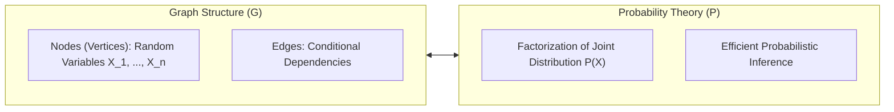

## Table of Contents

- [Overview & Motivation](#overview--motivation)
- [Types of Graphical Models](#types-of-graphical-models)
  - [[a] Bayesian Networks (Directed)](#a-bayesian-networks-directed)
  - [[b] Markov Networks (Undirected)](#b-markov-networks-undirected)
- [Quick Examples](#quick-examples)
  - [Directed PGM & OLS Regression](#directed-pgm--ols-regression)
  - [Directed PGM & Naive Bayes](#directed-pgm--naive-bayes)
- [A. Representation](#a-representation)
  - [1. Bayesian Network](#1-bayesian-network)
    - [Evidence & Conditioning Patterns](#evidence--conditioning-patterns)
    - [D-Separation (Explaining Away)](#d-separation-explaining-away)
    - [Template Models & Global Structure](#template-models--global-structure)
    - [Local Structure in CPDs](#local-structure-in-cpds)
  - [2. Markov Network](#2-markov-network)
- [B. Inference](#b-inference)
  - [Inference 01: Exact Inference (Enumeration & Variable Elimination)](#inference-01-exact-inference-enumeration--variable-elimination)
  - [Inference 02: Approximate Inference via Sampling](#inference-02-approximate-inference-via-sampling)
    - [1. Importance Sampling](#1-importance-sampling)
    - [2. Inverse Transform Sampling](#2-inverse-transform-sampling)
    - [3. Rejection Sampling](#3-rejection-sampling)
    - [4. MCMC & Gibbs Sampling](#4-mcmc--gibbs-sampling)
- [Bayesian Neural Networks (BNNs)](#bayesian-neural-networks-bnns)
  - [Scaling & Stochastic Gradient Langevin Dynamics (SGLD)](#scaling--stochastic-gradient-langevin-dynamics-sgld)
  - [Dynamic Bayesian Neural Networks](#dynamic-bayesian-neural-networks)
- [Python Code Examples](#python-code-examples)
  - [1. Bayesian Network & Exact Inference (`pgmpy`)](#1-bayesian-network--exact-inference-pgmpy)
  - [2. Importance & Rejection Sampling (`numpy`)](#2-importance--rejection-sampling-numpy)
  - [3. Gibbs Sampling (`numpy`)](#3-gibbs-sampling-numpy)
  - [4. Stochastic Gradient Langevin Dynamics (`torch`)](#4-stochastic-gradient-langevin-dynamics-torch)

## Overview & Motivation

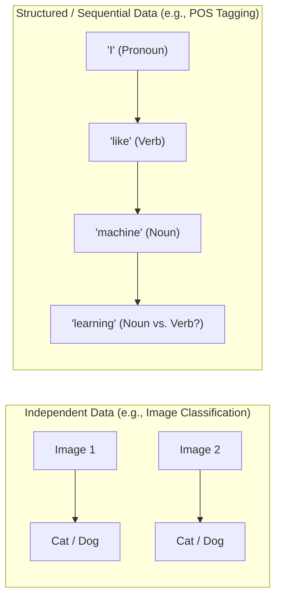

- **Independent vs. Dependent Data:** Standard classifiers often treat data points as independent (e.g., predicting whether an image contains a cat or a dog). In sequential or structured domains—such as `"I"`, `"like"`, `"machine"`, `"learning"`—words depend on context (`"learning"` can act as a noun or verb depending on surrounding tokens). PGMs provide a structured framework to model these **dependencies**.
- **Graph Components:** A PGM combines a graph with probability theory:
  - **Nodes (vertices):** Represent random variables.
  - **Edges:** Encode probabilistic relationships and dependencies between variables.
- **Core Advantages:**
  1. **Compact & Intuitive Representation:** Captures high-dimensional joint distributions clearly.
  2. **General-Purpose Inference:** Supports systematic probabilistic reasoning and querying via graph algorithms.
  3. **Parameter Efficiency:** Factorizing along conditional independencies drastically reduces the number of parameters needed compared to a full joint table—by dropping unnecessary edges whenever conditional independence holds.

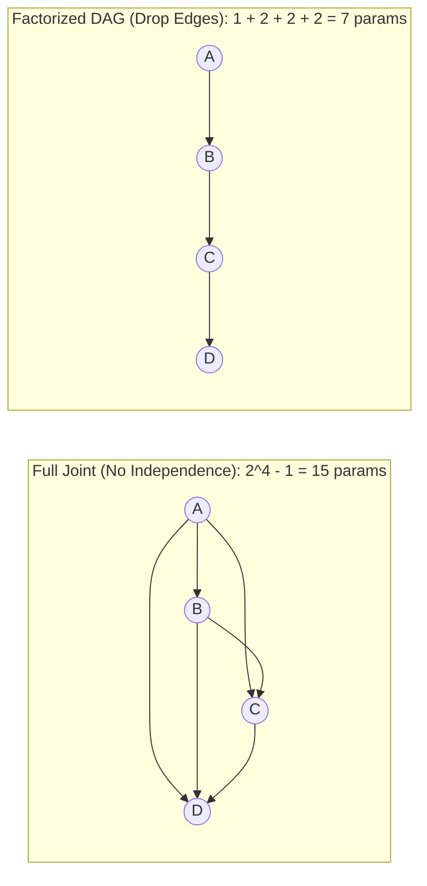

## Types of Graphical Models

Depending on whether edges are **directed** or **undirected**, graphical models fall into two main families:

### [a] Bayesian Networks (Directed)

Defined over an ordered **Directed Acyclic Graph (DAG)** representing a joint distribution $P(X_1, X_2, \dots, X_n)$. While variables may be marginally dependent, encoding **conditional independence** simplifies how the joint distribution factors.

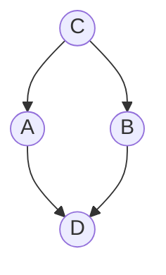

#### Key Rules: Factorization of Joint Distributions

Using the chain rule of probability:

$$P(a, b, c) = P(a \mid b, c)\,P(b, c) = P(a \mid b, c)\,P(b \mid c)\,P(c)$$

$$P(a, b, c) = P(a, b \mid c)\,P(c)$$

- **Conditional vs. Joint under conditioning:**
  - Conditional decomposition: $P(a \mid b, C) = \dfrac{P(a, b \mid C)}{P(b \mid C)}$
  - Joint decomposition: $P(a, b \mid C) = P(a \mid b, C)\,P(b \mid C)$
- **Notation Rule:** If a conditioning bar `|` is already present, append additional conditioning variables after a comma; otherwise introduce `|` before the conditioning variable(s).

### [b] Markov Networks (Undirected)

Use an **undirected graph** to model symmetric interactions and potential functions (clique factors) rather than directed causal edges.

## Quick Examples

### Directed PGM & OLS Regression

In Ordinary Least Squares (OLS) linear regression, outputs $y_i$ are generated from inputs $\mathbf{x}_i$, weights $\mathbf{w}$, and Gaussian noise variance $\sigma^2$:

$$y_i \mid \mathbf{x}_i, \mathbf{w}, \sigma^2 \sim \mathcal{N}(\mathbf{w}^{\top} \mathbf{x}_i, \sigma^2)$$

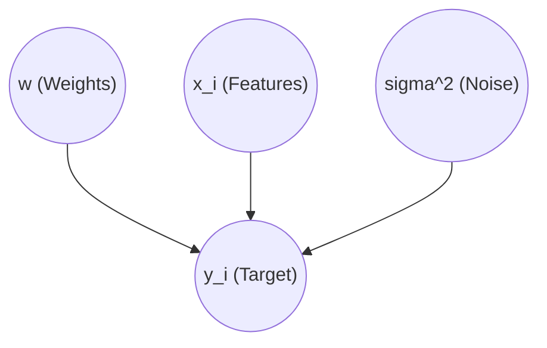

### Directed PGM & Naive Bayes

In a **Naive Bayes** graphical model, a single class node $Y$ acts as the parent of conditionally independent feature nodes $X_1, X_2, \dots, X_n$ given $Y$:

$$P(Y, X_1, \dots, X_n) = P(Y)\prod_{i=1}^{n} P(X_i \mid Y)$$

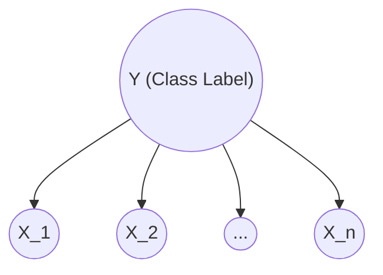

# A. Representation

## 1. Bayesian Network

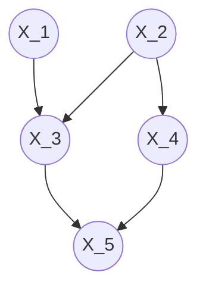

A **Bayesian Network** represents a joint probability distribution over random variables $X_1, X_2, \dots, X_n$ using a **DAG**:

$$P(X_1, X_2, \dots, X_n) = \prod_{i=1}^{n} P\big(X_i \mid \text{Pa}(X_i)\big)$$

where $\text{Pa}(X_i)$ denotes the parents of $X_i$ in the graph.

- Marries **uncertainty** with structured graph factorization.
- Makes direct and indirect influences between uncertain variables transparent.

### Evidence & Conditioning Patterns

- **Single Observation:**

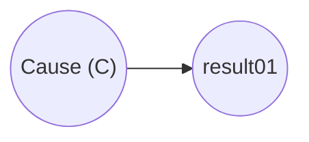

- **Multiple Observations (`result01`, `result02`, ...):**

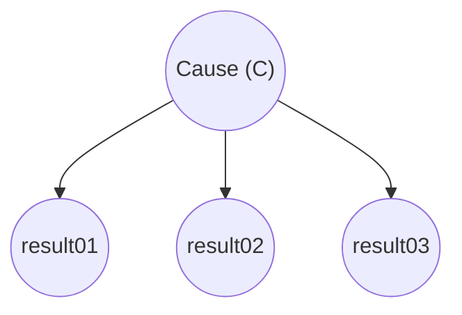

- **Conditional Independence Across Observations:** Given a common cause/parent $C$, its children are conditionally independent:

$$P(\text{result02} \mid \text{result01}, C) = P(\text{result02} \mid C)$$

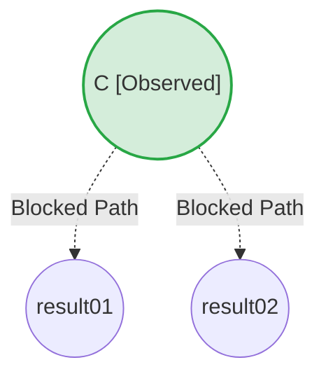

- **Multiple Latent Variables (Hidden Causes):**

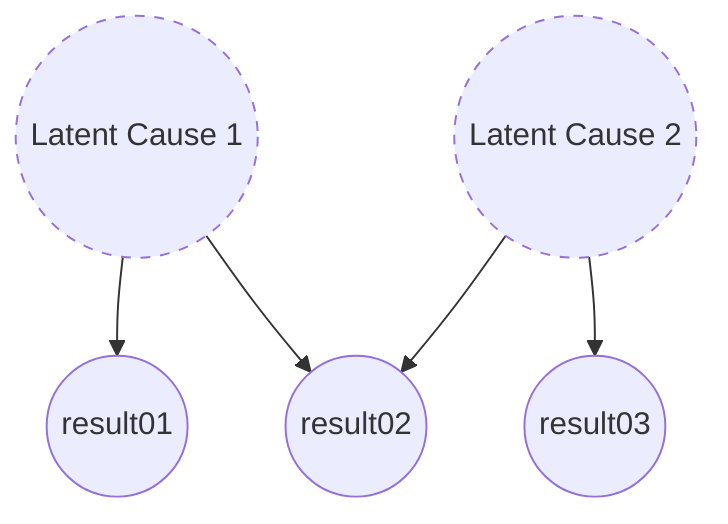

### Why Bayesian Networks?

Rather than enumerating every joint state combination explicitly, each node defines a local Conditional Probability Distribution (CPD) given its parents, reducing parameter count and enabling compact representation and inference.

| Representation | Number of Parameters ($n$ binary variables) | Growth Rate |
| :--- | :--- | :--- |
| Full Joint Probability Table | $2^{n} - 1$ | Exponential $\mathcal{O}(2^{n})$ |
| Bayesian Network (max $k$ parents/node) | $\le n \cdot 2^{k}$ | Linear in $n$ for bounded $k$ |

### Worked Example

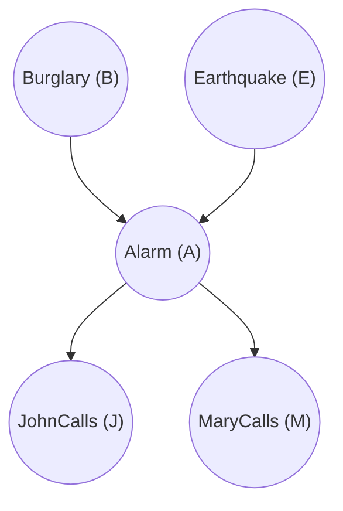

$$P(B, E, A, J, M) = P(B)\,P(E)\,P(A \mid B, E)\,P(J \mid A)\,P(M \mid A)$$

### D-Separation (Explaining Away)

In a **v-structure** ($A \rightarrow C \leftarrow B$), $A$ and $B$ are marginally independent ($A \perp B$). However, observing the shared child $C$ (or any descendant of $C$) activates the path and renders $A$ and $B$ **dependent** ($A \not\perp B \mid C$)—a phenomenon known as **explaining away**.

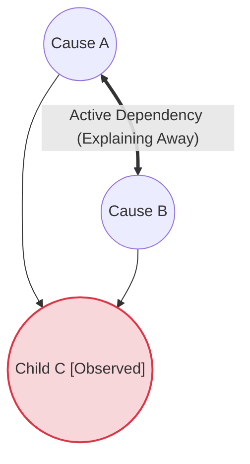

### Template Models & Global Structure

**Template Models** extend graphical models to handle repeated variables, time series, and shared structure across instances or time steps:

- Replicate **template variables** and share **CPDs (parameter sharing)** across repeated instances.
- Act as a compact specification of a larger unrolled ("ground") Bayesian network without increasing expressiveness beyond the unrolled DAG.
- Common examples include **Dynamic Bayesian Networks (DBNs)** for temporal sequences and **Object-Relational Models** (directed or undirected).

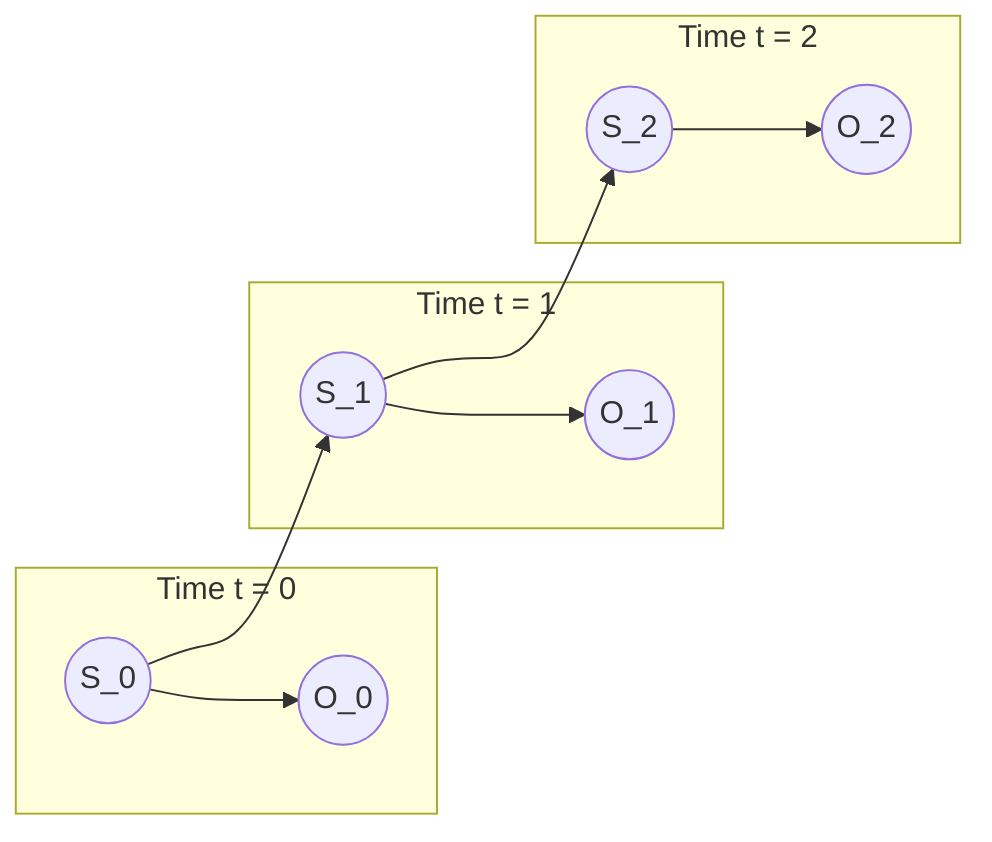

- **Temporal Models (DBNs & HMMs):**
  - **Dynamic Bayesian Networks (DBNs)** unroll a template network across discrete time slices to model evolving systems.
  - **Hidden Markov Models (HMMs)** are a specialized subclass with latent state chains and observations at each step.
- **Plate Models:**
  - Enclose repeated/indexed variables inside a **plate** (a box indicating indexing over items such as trials, users, or documents). Parameters outside all plates are shared across the replicated variables.

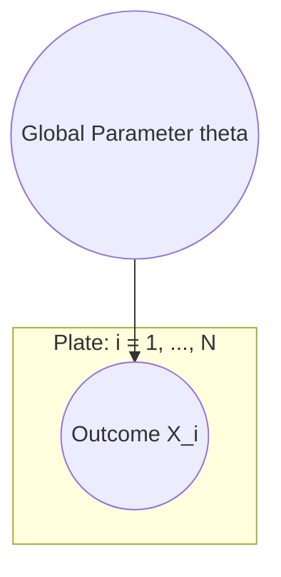

- **Index Subset Rule:** For a template variable $A\{X_1, \dots, X_k\}$ indexed by $X$, parent template variables (such as $B$ indexed by $U$) must have indices compatible with the child's scope so that grounding produces a valid dependency graph.
- **Ground Network:** Unrolling plates over concrete indices yields the **ground network**, enabling collective inference across correlated entities.

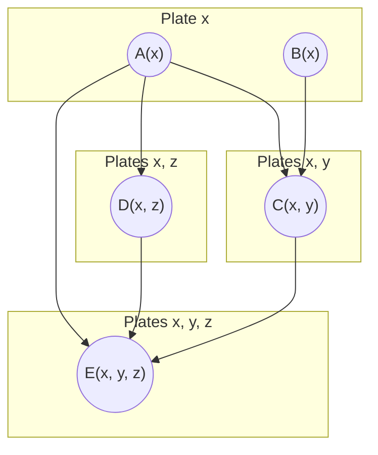

### Local Structure in CPDs

Instead of storing full tabular CPDs whose size grows exponentially with parent count, **local structure** parameterizes each node's CPD compactly:

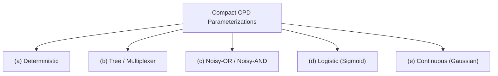

#### (a) Deterministic Structure

A child variable is a deterministic function of its parents ($Y = f(\text{Pa}(Y))$), and **Context-Specific Independence (CSI)** holds when independence between variables appears only for specific values of a conditioning variable $C$.

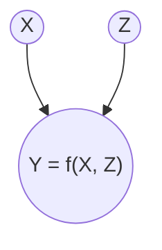

#### (b) Tree Structure & Multiplexer Model

Represents a CPD as a decision tree where internal nodes test parent values and leaves hold local distributions:

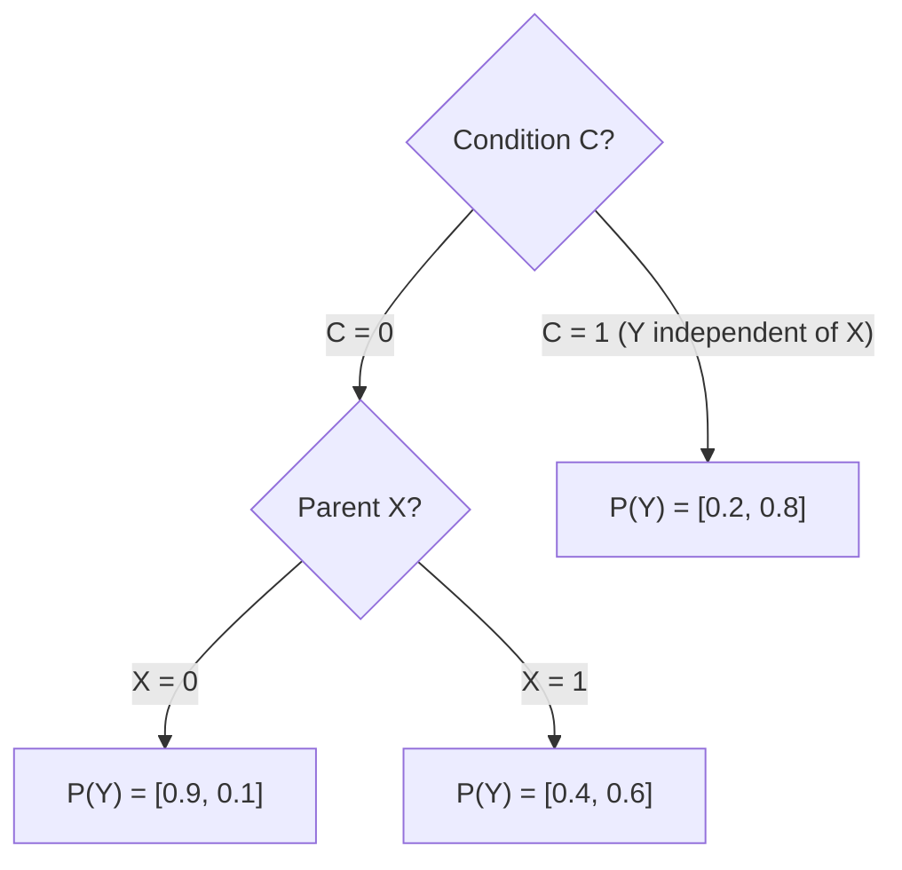

- **Multiplexer Model:** Uses a selector/multiplexer variable $S$ to route dependencies to different parent subsets ($X_1$ vs. $X_2$), drastically cutting parameter counts.

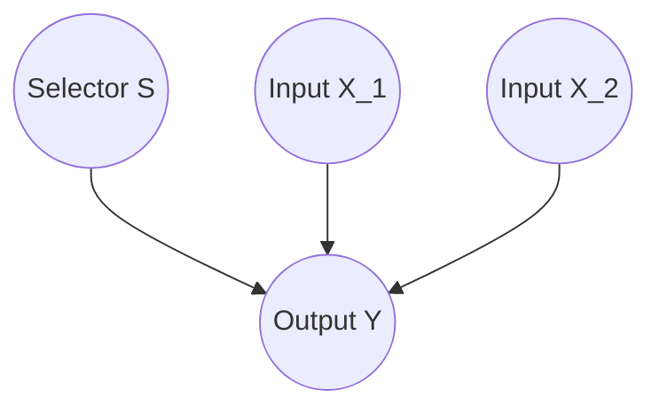

- **Practical Application (Printer Troubleshooting):** A selector/routing variable (local vs. network print path) determines which failure factors apply, reducing parameter count (e.g., from 145 down to ~55 in a classic diagnostic example).

```mermaid
graph TD
    Route{"Print Data Route?"}
    Route -- "Local Transport" --> Local["Local Cable / Driver / Port Status"]
    Route -- "Network Transport" --> Net["Network / Print Server / Queue Status"]
    Local --> Out(("Printer Output"))
    Net --> Out
```

#### (c) Noisy-OR & Noisy-AND Structure

Models **independence of causal influence**, where multiple parents $X_1, \dots, X_k$ affect a target $Y$ through independent intermediate mechanisms $Z_i$:

```mermaid
graph TD
    X0(("Leak X_0")) --> Z0(("Z_0"))
    X1(("X_1")) --> Z1(("Z_1"))
    X2(("X_2")) --> Z2(("Z_2"))
    Xk(("X_k")) --> Zk(("Z_k"))
    Z0 --> Y(("Y (OR / AND Aggregator)"))
    Z1 --> Y
    Z2 --> Y
    Zk --> Y
```

- **Noisy-OR:** $Y$ becomes true if at least one active cause (or a background leak factor) succeeds in turning it on:

$$P(Y = 1 \mid \mathbf{x}) = 1 - (1 - \lambda_0)\prod_{i : x_i = 1} (1 - \lambda_i)$$

- **Noisy-AND (and Noisy-MAX):** Aggregates independent causal contributions $Z_i$ into a combined effect to determine $Y$.

#### (d) Logistic Structure

Computes a linear combination of parent influences plus a bias term $w_0$, then passes the result through a sigmoid function:

$$z = w_0 + \sum_{i} w_i x_i, \qquad P(Y = 1 \mid \mathbf{x}) = \sigma(z) = \frac{1}{1 + e^{-z}}$$

```mermaid
graph LR
    X1(("X_1")) -- "w_1" --> Sum(("z = w_0 + sum(w_i X_i)"))
    X2(("X_2")) -- "w_2" --> Sum
    Xk(("X_k")) -- "w_k" --> Sum
    Sum --> Sig["Sigmoid sigma(z)"] --> Y(("Y"))
```

#### (e) Continuous Structure

Used when variables are continuous—for example, modeling a noisy sensor measurement around an underlying continuous temperature using a Gaussian (normal) distribution:

$$p(y \mid x) = \mathcal{N}\!\left(y;\, \mu_0 + w x,\, \sigma^{2}\right)$$

```mermaid
graph LR
    T(("True Temperature (Continuous)")) --> S(("Sensor Reading ~ N(T, sigma^2)"))
```

## 2. Markov Network

A **Markov Network** (Markov Random Field) uses an **undirected graph** $G = (V, E)$ to represent conditional independencies via graph separation: two subsets of nodes $A$ and $B$ are conditionally independent given $C$ ($A \perp B \mid C$) if every path between $A$ and $B$ passes through $C$.

```mermaid
graph TD
    X1(("X_1")) --- X2(("X_2"))
    X2 --- X3(("X_3"))
    X3 --- X4(("X_4"))
    X4 --- X1
    X1 --- X3
```

### Global Structure

The joint distribution factorizes over maximal cliques (or factor potentials $\phi_c(\mathbf{x}_c)$):

$$P(\mathbf{x}) = \frac{1}{Z} \prod_{c \in \mathcal{C}} \phi_c(\mathbf{x}_c), \qquad Z = \sum_{\mathbf{x}} \prod_{c \in \mathcal{C}} \phi_c(\mathbf{x}_c)$$

where $Z$ is the **partition function** (normalizing constant). Unlike Bayesian networks, edges in a Markov network represent symmetric affinity rather than causal direction.

### Local Structure

Factor potentials $\phi_c(\mathbf{x}_c) > 0$ are commonly parameterized in log-linear (energy-based) form:

$$\phi_c(\mathbf{x}_c) = \exp\big(-E_c(\mathbf{x}_c)\big) = \exp\!\left(\sum_k w_k f_k(\mathbf{x}_c)\right)$$

using feature functions $f_k$ and weights $w_k$, reducing parameter count when features are shared across cliques or spatial positions.

# B. Inference

```mermaid
graph LR
    Model["PGM (Graph + Factors)"] --> Query["Query Q & Evidence E = e"]
    Query --> Exact["Exact Inference (Enumeration, Variable Elimination)"]
    Query --> Approx["Approximate Inference (Importance, Rejection, MCMC / Gibbs)"]
```

Common inference tasks include:

1. **Posterior Inference (Marginal / Conditional Queries):** Computing $P(\mathbf{Q} \mid \mathbf{E} = \mathbf{e})$ for query variables $\mathbf{Q}$ given observed evidence $\mathbf{E}$.
2. **MAP / MPE Inference:** Finding the most probable assignment $\arg\max_{\mathbf{q}} P(\mathbf{q} \mid \mathbf{e})$.
3. **Bidirectional / Diagnostic Reasoning:** Inferring causes from effects (e.g., inferring whether a burglary occurred given reports that an alarm sounded).

## Inference 01: Exact Inference (Enumeration & Variable Elimination)

**Enumeration** computes $P(Q \mid \mathbf{E} = \mathbf{e})$ by summing joint probabilities over all hidden (non-query, non-evidence) variables $\mathbf{H}$:

$$P(Q \mid \mathbf{E} = \mathbf{e}) = \frac{P(Q, \mathbf{E} = \mathbf{e})}{P(\mathbf{E} = \mathbf{e})} = \frac{\sum_{\mathbf{h}} P(Q, \mathbf{E} = \mathbf{e}, \mathbf{H} = \mathbf{h})}{\sum_{q', \mathbf{h}} P(Q = q', \mathbf{E} = \mathbf{e}, \mathbf{H} = \mathbf{h})}$$

- **Example (Burglary / Alarm / John & Mary):** Given evidence that both John and Mary called, summing over the hidden variables yields:

$$P(\text{Burglary} = \text{True} \mid \text{JohnCalls}, \text{MaryCalls}) \approx 0.284$$

```mermaid
graph TD
    B(("Burglary [Query]")) --> A(("Alarm [Hidden]"))
    E(("Earthquake [Hidden]")) --> A
    A --> J(("JohnCalls = True [Evidence]"))
    A --> M(("MaryCalls = True [Evidence]"))
    style B fill:#cce5ff,stroke:#004085,stroke-width:2px
    style J fill:#d4edda,stroke:#155724,stroke-width:2px
    style M fill:#d4edda,stroke:#155724,stroke-width:2px
```

### Speeding Up Exact Inference: Variable Elimination

Plain enumeration repeats identical sub-expressions across terms. **Variable Elimination** interleaves factor multiplication and marginalization (summing out variables one at a time) so intermediate factors remain compact.

```mermaid
flowchart LR
    F["Initial Factors: f_B, f_E, f_A, f_J, f_M"] --> M1["Multiply factors containing E & sum out E"]
    M1 --> F1["New Factor f_1(B, A)"]
    F1 --> M2["Multiply factors containing A & sum out A"]
    M2 --> F2["New Factor f_2(B)"]
    F2 --> Norm["Normalize -> P(B | J=1, M=1)"]
```

## Inference 02: Approximate Inference via Sampling

When exact inference is intractable, **Monte Carlo sampling** approximates expectations $\mathbb{E}_{P}[f(X)] \approx \frac{1}{N}\sum_{i=1}^{N} f(x^{(i)})$ by drawing samples and averaging evaluations.

```mermaid
flowchart LR
    Dist["Target or Proposal Distribution"] --> Draw["Draw N Samples x^(1), ..., x^(N)"]
    Draw --> Eval["Evaluate f(x^(i))"]
    Eval --> Avg["Empirical Average (1/N) sum f(x^(i))"]
```

### 1. Importance Sampling

When sampling directly from $P(x)$ is difficult, draw samples from a **proposal distribution** $q(x)$ and weight each sample by $w(x) = \frac{P(x)}{q(x)}$:

$$\mathbb{E}_{P}[f(X)] = \int f(x)\frac{P(x)}{q(x)} q(x)\,dx \approx \frac{1}{N}\sum_{i=1}^{N} \frac{P(x^{(i)})}{q(x^{(i)})} f(x^{(i)}), \quad x^{(i)} \sim q(x)$$

If $P(x) = \tilde{P}(x)/Z_P$ and $q(x) = \tilde{q}(x)/Z_q$ have unknown normalizing constants, **self-normalized importance sampling** uses unnormalized weights $\tilde{w}(x) = \frac{\tilde{P}(x)}{\tilde{q}(x)}$:

$$\mathbb{E}_{P}[f(X)] \approx \frac{\sum_{i=1}^{N} \tilde{w}(x^{(i)}) f(x^{(i)})}{\sum_{i=1}^{N} \tilde{w}(x^{(i)})}$$

### 2. Inverse Transform Sampling

Given a target distribution with Cumulative Distribution Function (CDF) $F_X(x)$:

- **Invertible CDF:** Draw $u \sim \text{Uniform}(0, 1)$ and set $x = F_X^{-1}(u)$.
- **Non-invertible / Discrete CDF:** Partition $[0, 1)$ into intervals corresponding to cumulative probability masses and map $u$ to the matching interval/value.

```mermaid
flowchart LR
    U["u ~ Uniform(0, 1)"] --> Inv["Apply Inverse CDF: x = F_X^{-1}(u)"] --> X["Sample x ~ P(X)"]
```

### 3. Rejection Sampling

- **Discrete / Set Sampling:** Sample uniformly from an enclosing bounding region and keep points falling inside the target set.
- **Continuous / Density Sampling:** Draw candidate samples $x \sim q(x)$ from a tractable proposal scaled by $M$ so $M\,q(x) \ge \tilde{p}(x)$, and accept each draw with probability $\frac{\tilde{p}(x)}{M\,q(x)}$.

```mermaid
flowchart TD
    S["Sample x ~ q(x) and u ~ Uniform(0, 1)"] --> Check{"u < p_tilde(x) / (M * q(x)) ?"}
    Check -- "Yes" --> Acc["Accept x"]
    Check -- "No" --> Rej["Reject x & Repeat"]
```

### 4. MCMC & Gibbs Sampling

**Markov Chain Monte Carlo (MCMC)** constructs a Markov chain whose stationary distribution matches the target posterior $P(\mathbf{x})$:

```mermaid
graph LR
    X0(("x^(0)")) -- "Transition T" --> X1(("x^(1)"))
    X1 -- "Transition T" --> X2(("x^(2)"))
    X2 -- "..." --> Xt(("x^(t) ~ P(x)"))
```

- **Metropolis & Metropolis–Hastings:** Propose a candidate state $x'$ from $q(x' \mid x)$ and accept with probability:

$$\alpha = \min\!\left(1, \frac{\tilde{p}(x')\,q(x \mid x')}{\tilde{p}(x)\,q(x' \mid x)}\right)$$

- **Gibbs Sampling:** Updates one variable (or block) at a time by sampling from its full conditional distribution $P(x_i \mid \mathbf{x}_{-i})$ given the current values of all other variables.

```mermaid
flowchart LR
    Init["State (theta^(t), phi^(t))"] --> Step1["Sample theta^(t+1) ~ P(theta | phi^(t), y)"]
    Step1 --> Step2["Sample phi^(t+1) ~ P(phi | theta^(t+1), y)"]
    Step2 --> Next["Next State (theta^(t+1), phi^(t+1))"]
```

## Bayesian Neural Networks (BNNs)

Standard neural networks learn **point estimates** of weights $\mathbf{w}$, which often yield overconfident predictions in regions with scarce or out-of-distribution data. **Bayesian Neural Networks** place a **prior** $p(\mathbf{w})$ over weights and infer a **posterior** $p(\mathbf{w} \mid \mathcal{D})$ given data $\mathcal{D}$:

$$p(\mathbf{w} \mid \mathcal{D}) = \frac{p(\mathcal{D} \mid \mathbf{w})\,p(\mathbf{w})}{p(\mathcal{D})}$$

Predictions marginalize over weight uncertainty:

$$p(y_{\text{new}} \mid \mathbf{x}_{\text{new}}, \mathcal{D}) = \int p(y_{\text{new}} \mid \mathbf{x}_{\text{new}}, \mathbf{w})\,p(\mathbf{w} \mid \mathcal{D})\,d\mathbf{w}$$

```mermaid
graph LR
    Prior["Prior p(w)"] --> Post["Posterior p(w | D)"]
    Data["Dataset D"] --> Lik["Likelihood p(D | w)"]
    Lik --> Post
    Post --> Pred["Predictive Distribution p(y_new | x_new, D)"]
```

### Scaling & Stochastic Gradient Langevin Dynamics (SGLD)

Exact posterior inference is intractable for deep networks, so practitioners rely on **Variational Inference** or **Stochastic Gradient MCMC**.

**Stochastic Gradient Langevin Dynamics (SGLD)** combines minibatch stochastic gradients with injected Gaussian noise $\boldsymbol{\eta}_t \sim \mathcal{N}(\mathbf{0}, \epsilon_t \mathbf{I})$ so parameter updates converge toward samples from the posterior:

$$\Delta \mathbf{w}_t = \frac{\epsilon_t}{2}\left(\nabla \log p(\mathbf{w}_t) + \frac{N}{n}\sum_{i \in \mathcal{B}_t} \nabla \log p(y_i \mid \mathbf{x}_i, \mathbf{w}_t)\right) + \boldsymbol{\eta}_t$$

#### Limitations of Gibbs Sampling in BNNs

- **High Dimensionality:** Updating one weight coordinate at a time scales poorly when a network has millions of parameters.
- **Minibatch Constraints:** Standard Gibbs updates typically require full-dataset conditionals rather than minibatch stochastic estimates.
- **Burn-In Cost:** Chains require convergence during training, though collected posterior weight samples can be reused at test time for uncertainty-aware ensembling.

### Dynamic Bayesian Neural Networks

**Dynamic Bayesian Neural Networks** combine temporal Bayesian modeling across time steps $t - 1 \to t$ with neural network parameterizations to capture non-linear state transitions and uncertainty over sequential data:

```mermaid
graph LR
    Z0(("z_(t-1)")) -- "Bayesian NN Transition" --> Z1(("z_t"))
    Z0 -- "Emission" --> X0(("x_(t-1)"))
    Z1 -- "Emission" --> X1(("x_t"))
```

## Python Code Examples

### 1. Bayesian Network & Exact Inference (`pgmpy`)

This example builds the classic **Burglary–Earthquake–Alarm–JohnCalls–MaryCalls** network and computes $P(\text{Burglary} \mid \text{JohnCalls}=1, \text{MaryCalls}=1)$ using Variable Elimination.

```bash
pip install pgmpy
```

```python
from pgmpy.models import DiscreteBayesianNetwork
from pgmpy.factors.discrete import TabularCPD
from pgmpy.inference import VariableElimination

# 1. Define DAG structure
model = DiscreteBayesianNetwork([
    ("Burglary", "Alarm"),
    ("Earthquake", "Alarm"),
    ("Alarm", "JohnCalls"),
    ("Alarm", "MaryCalls"),
])

# 2. Define Conditional Probability Distributions (CPDs)
cpd_b = TabularCPD(variable="Burglary", variable_card=2, values=[[0.999], [0.001]])
cpd_e = TabularCPD(variable="Earthquake", variable_card=2, values=[[0.998], [0.002]])

cpd_a = TabularCPD(
    variable="Alarm",
    variable_card=2,
    values=[
        # P(Alarm=0 | B, E)
        [0.999, 0.71, 0.06, 0.05],
        # P(Alarm=1 | B, E)
        [0.001, 0.29, 0.94, 0.95],
    ],
    evidence=["Burglary", "Earthquake"],
    evidence_card=[2, 2],
)

cpd_j = TabularCPD(
    variable="JohnCalls",
    variable_card=2,
    values=[[0.95, 0.10], [0.05, 0.90]],
    evidence=["Alarm"],
    evidence_card=[2],
)

cpd_m = TabularCPD(
    variable="MaryCalls",
    variable_card=2,
    values=[[0.99, 0.30], [0.01, 0.70]],
    evidence=["Alarm"],
    evidence_card=[2],
)

model.add_cpds(cpd_b, cpd_e, cpd_a, cpd_j, cpd_m)
assert model.check_model()

# 3. Exact inference via Variable Elimination
infer = VariableElimination(model)
posterior = infer.query(
    variables=["Burglary"],
    evidence={"JohnCalls": 1, "MaryCalls": 1},
)
print(posterior)
# P(Burglary=1 | JohnCalls=1, MaryCalls=1) ≈ 0.2842
```

### 2. Importance & Rejection Sampling (`numpy`)

Approximating $\mathbb{E}_P[X^2]$ under an unnormalized target density $\tilde{p}(x) = \exp(-0.5 x^2)(1 + \sin^2(x))$ using a Gaussian proposal $q(x) = \mathcal{N}(0, 1.5^2)$.

```python
import numpy as np

rng = np.random.default_rng(42)

def p_tilde(x):
    return np.exp(-0.5 * x**2) * (1.0 + np.sin(x) ** 2)

def q_pdf(x, sigma=1.5):
    return np.exp(-0.5 * (x / sigma) ** 2) / (np.sqrt(2 * np.pi) * sigma)

# --- Self-Normalized Importance Sampling ---
N = 50_000
sigma = 1.5
samples_q = rng.normal(0.0, sigma, size=N)
weights = p_tilde(samples_q) / q_pdf(samples_q, sigma)
weights /= np.sum(weights)

est_importance = np.sum(weights * (samples_q**2))
print(f"Importance Sampling E[X^2]: {est_importance:.4f}")

# --- Rejection Sampling ---
# Bound M such that M * q_pdf(x) >= p_tilde(x) for all x
M = 2.0 * np.sqrt(2 * np.pi) * sigma
candidates = rng.normal(0.0, sigma, size=N)
u = rng.uniform(0.0, 1.0, size=N)
accepted = candidates[u < p_tilde(candidates) / (M * q_pdf(candidates, sigma))]

print(f"Rejection Sampling E[X^2]:  {np.mean(accepted**2):.4f} (acceptance rate: {len(accepted)/N:.2%})")
```

### 3. Gibbs Sampling (`numpy`)

Sampling from a correlated 2D Gaussian $\mathcal{N}\!\left(\begin{bmatrix}0 \\ 0\end{bmatrix}, \begin{bmatrix}1 & \rho \\ \rho & 1\end{bmatrix}\right)$ by alternating between exact 1D conditional distributions $x_1 \mid x_2 \sim \mathcal{N}(\rho x_2, 1 - \rho^2)$ and $x_2 \mid x_1 \sim \mathcal{N}(\rho x_1, 1 - \rho^2)$.

```python
import numpy as np

def gibbs_bivariate_normal(n_samples=10_000, burn_in=1_000, rho=0.8, seed=42):
    rng = np.random.default_rng(seed)
    cond_std = np.sqrt(1.0 - rho**2)
    x1, x2 = 0.0, 0.0
    samples = np.empty((n_samples + burn_in, 2))

    for t in range(n_samples + burn_in):
        x1 = rng.normal(rho * x2, cond_std)
        x2 = rng.normal(rho * x1, cond_std)
        samples[t] = (x1, x2)

    return samples[burn_in:]

chain = gibbs_bivariate_normal()
print("Empirical Mean:", np.round(chain.mean(axis=0), 3))
print("Empirical Corr:", np.round(np.corrcoef(chain.T)[0, 1], 3))
```

### 4. Stochastic Gradient Langevin Dynamics (`torch`)

A minimal SGLD step for Bayesian regression that injects calibrated Gaussian noise into minibatch gradient updates to collect posterior weight samples.

```python
import torch
import torch.nn as nn

torch.manual_seed(0)

# Synthetic regression data
X = torch.linspace(-3, 3, 200).unsqueeze(1)
y = torch.sin(X) + 0.15 * torch.randn_like(X)

model = nn.Sequential(
    nn.Linear(1, 32),
    nn.Tanh(),
    nn.Linear(32, 1),
)

N = len(X)
batch_size = 50
prior_std = 1.0
noise_var = 0.15**2
posterior_samples = []

for step in range(1, 1501):
    # Decaying step size satisfying Robbins-Monro conditions
    lr = 1e-3 * (step ** -0.55)
    idx = torch.randperm(N)[:batch_size]
    xb, yb = X[idx], y[idx]

    model.zero_grad()
    pred = model(xb)

    # Negative log-likelihood + Gaussian prior penalty
    nll = 0.5 * torch.mean((yb - pred) ** 2) / noise_var
    log_prior = sum(0.5 * torch.sum(p**2) / (prior_std**2) for p in model.parameters()) / N
    loss = nll + log_prior
    loss.backward()

    with torch.no_grad():
        for p in model.parameters():
            grad = N * p.grad
            noise = torch.randn_like(p) * (lr**0.5)
            p.sub_(0.5 * lr * grad - noise)

    # Collect thinned samples after burn-in
    if step > 800 and step % 50 == 0:
        posterior_samples.append([p.detach().clone() for p in model.parameters()])

print(f"Collected {len(posterior_samples)} posterior weight samples via SGLD.")
```